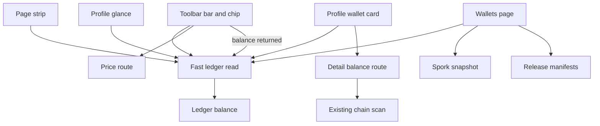
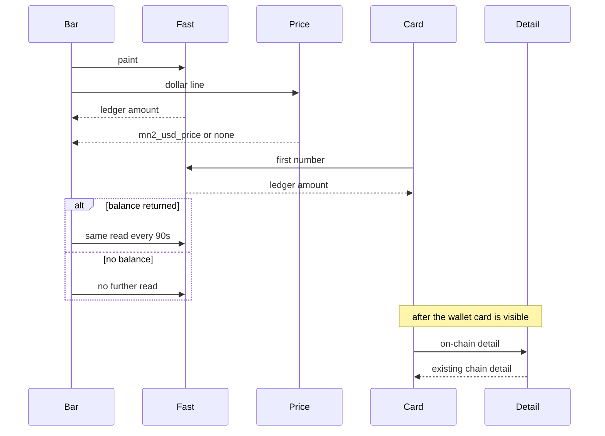

# Wallet Load, Live Updates, and Downloads - Plan

## Goal Capsule

- **Objective:** A person can open the site, see their MN2 balance and dollar price, watch that balance stay current, and download the current daemon and desktop wallet with a checksum, including when the coin daemon does not answer.
- **Means:** A ledger read for the chrome, the glance, and the wallet card's first number, the existing detail read after that card is visible, a timed refresh of the ledger read, the existing price route for the dollar line, and release manifests for downloads (KTD1, KTD2, KTD4).
- **Authority:** Requirements win on product behavior. Key Technical Decisions win on mechanism. Units override neither.
- **Execution:** Code in this repo. The daemon binary stays in the MasterNoder2 release line.
- **Stop:** Stop if the work turns `SPORK_112_EXCHANGE_LIVE_TRADING` or `SPORK_114_PAYOUT_LIVE` on by default, or if the chrome read scans unspent outputs, creates a deposit address, or calls Chainz.
- **Ships:** An implementer lands the units here. Publishing a release and signing a spork stay with the operator.

---

## Product Contract

### Summary

The toolbar shows the ledger balance without a chain scan, the dollar amount from the existing price route, and a timed refresh of that balance. `/wallets` links the current daemon and desktop wallet with checksums, and shows whether the four network gates are active.

### Problem Frame

The balance people see is held until the server scans unspent outputs, reconciles, and asks Chainz for a price. The dollar line on the global bar looks up field names the price route does not return, so it stays blank. `/wallets` sends the daemon card to the news page. The setup guide still names daemon v1.2.2.0, while the release scripts publish v1.3.1.0, including the four sporks the site already gates on. The wallet chip script is included only on two pages the page list does not serve.

### Requirements

**Wallet chrome**

- R1. On a page the toolbar serves, the visible MN2 balance comes from the ledger and still appears when the coin daemon does not answer.
- R2. The dollar amount comes from `GET /api/mn2/price` field `mn2_usd_price`, on a request separate from the ledger read. The rate stays blank only when that route returns no price.
- R3. Wallet links, including Deposit and Withdraw, open the profile wallet card and the matching panel.

**Live balance**

- R4. While a signed-in person keeps a toolbar page open, the balance updates without a reload and without a chain scan.

**Downloads and sporks**

- R5. `/wallets` links the current daemon tarball and the Linux and Windows desktop wallets, each with version and sha256, from the release the build scripts publish.
- R6. The wallet shows whether `SPORK_112_EXCHANGE_LIVE_TRADING`, `SPORK_113_CASINO_REAL_MONEY`, `SPORK_114_PAYOUT_LIVE`, and `SPORK_115_MAINTENANCE_MODE` are active. Those four are the missing daemon sporks, created by the existing patch. No spork id above 115 is added.
- R7. Withdrawal confirmation, spork signing, and running a downloaded binary stay human actions.

### Actors

- A1. A visitor with a session, or with the stored user id the toolbar already sends.
- A2. The operator who publishes releases and signs sporks.
- A3. An agent that may read the same fast balance the page reads.

### Key Flows

- F1. Toolbar paint
  - **Trigger:** A page in the page list loads the toolbar.
  - **Actors:** A1
  - **Steps:** The bar, the wallet chip, the page strip, and the profile card's first number request the fast ledger read. The dollar line requests the price route. The card requests the detail balance after it is visible.
  - **Covered by:** R1, R2, R3
- F2. Balance refresh
  - **Trigger:** The fast read returned a balance.
  - **Actors:** A1
  - **Steps:** The bar repeats that read on the interval in KTD2. It does not open a second long-lived stream. The public activity stream is left unchanged.
  - **Covered by:** R4
- F3. Downloads
  - **Trigger:** A1 opens `/wallets`.
  - **Actors:** A1, A2
  - **Steps:** The static page fetches the fast balance, the spork snapshot, and the release payload in the browser. Each link is the release-config base plus a fixed filename. The sha256 comes from the manifest. The link does not use a URL field from the manifest body.
  - **Covered by:** R5, R6

### Acceptance Examples

- AE1. Covers R1. Given the daemon RPC raises, when the toolbar loads for a known ledger of 12.5 MN2, then the balance shows 12.5 and the request does not scan unspent outputs.
- AE2. Covers R2. Given `GET /api/mn2/price` returns `mn2_usd_price` 0.012, when the bar loads, then the rate shows 0.012. Given that route returns no price, then the rate is empty. The ledger read does not wait on that route.
- AE3. Covers R3. Given `/profile?tab=wallet&wallet=deposit`, when the wallet route is shown, then the deposit panel is visible and the page scrolls to `mn2-wallet`.
- AE4. Covers R4. Given a ledger that changes from 12.5 to 13, when the bar's refresh interval elapses, then the bar shows 13. The page does not open a balance event stream.
- AE5. Covers R5. Given both release manifests for v1.3.1.0, when `/wallets` renders downloads, then the daemon link and both desktop-wallet links show that version and the manifest sha256. Given a manifest 404, then the row says the manifest is unavailable and does not offer a v1.2.2.0 URL.
- AE6. Covers R6, R7. Given `SPORK_112_EXCHANGE_LIVE_TRADING` at 4070908800, when the snapshot is served from defaults, then that spork is inactive and the source is default. No route accepts a spork update.

### Scope Boundaries

This plan covers the toolbar balance, the wallet chip on toolbar pages, the profile wallet card's first paint and deep links, `/wallets` downloads, the four spork gates, and a timed refresh of the ledger balance.

#### Deferred to Follow-Up Work

- Rejecting an arbitrary `user_id` query on balance and deposit-address reads. The toolbar still identifies many visitors that way.
- An agent capability-map entry for the fast read. Agents use the same HTTP route. This plan adds no agent blueprint.
- A Socket.IO server. `static/js/realtime-client.js` is unused, and no page includes it.
- A balance event stream on toolbar pages. Those pages already hold the public activity stream, and the process pool is 2 processes by 2 threads (`uwsgi_common.ini`).
- Spork ids above 115, and any edit to the defaults of `SPORK_112_EXCHANGE_LIVE_TRADING` or `SPORK_114_PAYOUT_LIVE`.
- Switching shop, lab, and the exchange bridge off the detail balance route. Those screens keep today's call.
- Vendoring the MasterNoder2 tree into this repo.

#### Outside this product's identity

- Rewriting the video generator, shop checkout, casino bets, exchange custody, or the staking minter.
- The generator-and-agent rethink in `docs/PROJECT_RETHINK.md`.

### Sources

- `backend/routes/mn2_routes.py` returns the balance only after chain balance, reconcile, the Chainz ticker, and holds.
- `backend/services/mn2_onchain_wallet.py` scans unspent outputs with a 2 second RPC timeout. Reconcile scans again.
- `static/js/mn2-global-bar.js` reads `mn2_balance`, then looks up `price_usd` or `usd`. `GET /api/mn2/price` returns `mn2_usd_price`.
- `static/js/mn2-wallet-quick-access.js` is included from `creator/index.html` and `terms/index.html`. Those slugs are absent from `PAGES` in `backend/routes/all_page_routes.py`. The toolbar never creates `#navToolbarMn2Wallet`.
- `docs/MN2_STAKING_PLAN.md` prefers server-sent events, with polling kept as fallback.
- `scripts/mn2_release_config.py` targets `v1.3.1.0`. `docs/MN2_DAEMON_SETUP.md` still names `v1.2.2.0`.
- `docs/patches/mn2-daemon-v1.3.1-exchange-sporks.patch` adds sporks 112–115. `backend/services/mn2_spork_service.py` already has the same ids and defaults.
- `external/` is gitignored, so `spork.h` is not in this repo. No Python module constructs a Socket.IO server.

---

## Planning Contract

### Key Technical Decisions

- KTD1. **Fast and detail stay separate routes on the mn2 blueprint.** The fast read returns `mn2_balance`, `signed_in`, and `wallet_mode`. It carries no price fields and does not call `chainz_ticker_usd_with_updated`. The dollar line stays on `GET /api/mn2/price`, which already returns `mn2_usd_price` and fills its cache on a miss. The fast read does not call chain balance, reconcile, or deposit-address creation. Its response is `Cache-Control: private, no-store`. `GET /api/mn2/balance` stays the detail payload, including its current chain scan. A second blueprint would miss lite registration, which loads `mn2_bp` explicitly. Content negotiation on the detail route is the rejected alternative. One URL cannot be both the chain payload and the chrome read.
- KTD2. **The toolbar refreshes the fast read. It does not open a balance stream.** When the fast read returned a balance, the global bar requests it again every 90 seconds. A response with no balance is fetched once. The bar does not construct an `EventSource` for a balance URL. Toolbar pages already open `GET /api/activity/stream`, and that generator holds a thread until the client leaves. `uwsgi_common.ini` is 2 processes by 2 threads, with `harakiri` at 300 seconds. A second held stream on a signed-in tab can occupy the pool, and a heartbeat keeps the worker alive until harakiri. The request asked for a websocket. A socket server was rejected because none exists. A per-page balance event stream was rejected for the same pool. The public activity stream does not gain an `mn2_balance` field.
- KTD3. **Fast-read identity matches the toolbar, and paint creates nothing.** A live session user wins. Otherwise the query `user_id` is used. No session and no query id returns `signed_in: false` and omits `mn2_balance`. `signed_in` is true only for a session. Deposit-address, wallet-frame, and wallet refresh run when the person opens Deposit or asks for an address. `register_ai_user_lifecycle_middleware` runs on every `/api/` request and, for `default_user`, calls `identify_or_create_user`, which calls `ensure_user_address` for a new visitor. The hook skips the fast-read path. A flag set inside the view is too late, because the hook runs first.
- KTD4. **Downloads and spork rows are client fetches on a static page.** `/wallets` HTML stays publicly cacheable. The browser fetches the fast read, a spork snapshot, and a release payload. The payload is built from `scripts/mn2_release_config.py` plus `RELEASE_MANIFEST.json` and `QT_RELEASE_MANIFEST.json` for `v1.3.1.0`. Rows are the daemon tarball, `MasterNoder2-qt-linux.tar.gz`, and `MasterNoder2-qt-win.zip`, each with url and sha256. A failed manifest fetch shows `v1.3.1.0` and that the manifest is unavailable. `docs/MN2_DAEMON_SETUP.md` stops hardcoding `v1.2.2.0` URLs and points at the release config. The snapshot covers the four gates in R6, with `value`, `active`, and `source` of `override`, `rpc`, or `default`. When the RPC cache is empty or stale, it refreshes once with the existing 2 second timeout. Source is `rpc` when that refresh returns values, and `SPORK_DEFAULTS` with source `default` only when the refresh yields nothing. It does not call the enforcement helpers, and it is not on the chrome's first paint. `update_spork` stays on the operator scripts.
- KTD5. **One toolbar chip.** The toolbar renders `#navToolbarMn2Wallet` and a dropdown bound to the fast read. Pages that do not already include `static/js/mn2-wallet-quick-access.js` do not gain its floating button, sticky bar, or W shortcut. Both profile scroll maps use `mn2-wallet`. The global bar and `/wallets` link to `/profile#mn2-wallet`.
- KTD6. **Spork creation is the existing patch.** Sporks 112–115 in `backend/services/mn2_spork_service.py` are the missing daemon sporks. `spork.h` is not in this repo, so this plan does not add a header comparison. Python defaults are not edited. `SPORK_112_EXCHANGE_LIVE_TRADING` and `SPORK_114_PAYOUT_LIVE` stay 4070908800.

### Assumptions

- The button in the request is the toolbar wallet chip together with the global MN2 bar.
- Reinventing the software, for this plan, means the wallet chrome, its live updates, sporks 112–115, and the download path.
- The balance refresh is the 90 second poll in KTD2. A WebSocket server and a second event stream are both deferred.
- Number holes in the spork list, including 1, 4, 11, and 12, are unused ids.
- Keeping query `user_id` on the fast read is acceptable here because the toolbar sends it. Session-only reads are deferred.
- The dollar line uses `GET /api/mn2/price`. The fast ledger read does not carry a price and does not call Chainz.
- Shop, lab, and the exchange bridge keep calling `GET /api/mn2/balance`. Their loading time is unchanged in this plan.
- `docs/solutions/` does not exist, so no prior learning constrains these choices.

### High-Level Technical Design

The 90 second repeat is the refresh in KTD2. The bar does not open a balance event stream beside the activity stream the toolbar already holds.

### Sequencing

U1 lands the fast read. U2 depends on it. U4 depends on U2 because both edit the bar and the page strip. U3 depends on U2 because both edit the profile wallet scripts. U5 depends on U1 and U3 because it edits `wallets/index.html` after the links move.

---

## Implementation Units

### U1. Fast ledger read

- **Goal:** Chrome can read the ledger when the daemon does not answer.
- **Requirements:** R1, R2
- **Dependencies:** none
- **Files:** `backend/routes/mn2_routes.py`, `backend/services/mn2_wallet_service.py`, `backend/middleware/ai_user_lifecycle_middleware.py`, `tests/unit/test_mn2_balance_fast.py`
- **Approach:** Add the route KTD1 describes on the existing mn2 blueprint. Leave `GET /api/mn2/balance` and `GET /api/mn2/price` as they are. Exempt the fast path from the lifecycle hook per KTD3.
- **Execution note:** Write a failing test for the fast contract before changing the detail handler. Keep a characterization test that the detail route still returns `onchain` and `reconcile`.
- **Patterns to follow:** `resolve_user_id` in `backend/services/account_resolution_service.py` with identification disabled. Existing spork tests monkeypatch env and avoid a live daemon.
- **Test scenarios:**
  - Session user with ledger 12.5 receives `mn2_balance` 12.5, `signed_in` true, and no unspent scan.
  - No session and query `user_id` of that same account receives 12.5 and `signed_in` false.
  - No session and no query id receives `signed_in` false, omits `mn2_balance`, and does not call identification.
  - RPC client raises. The fast read still returns 12.5.
  - The fast body has no `mn2_usd_price` and no `price_usd`.
  - Detail route for the same user still includes `onchain` and `reconcile`.
  - Through the Flask app, a request with no session and no `user_id` does not call `ensure_user_address` or `get_or_create_deposit_address`.
- **Verification:** The new test file passes, and a forced RPC failure still returns the ledger amount.

### U2. Chrome and profile first paint

- **Goal:** The bar, the glance, and the wallet card's first number use the fast read, and the card waits to create an address.
- **Requirements:** R1, R2, R3
- **Dependencies:** U1
- **Files:** `static/js/mn2-site-bridge.js`, `static/js/mn2-global-bar.js`, `static/js/mn2-page-strip-init.js`, `static/js/profile-mn2-wallet.js`, `static/js/profile-hub.js`, `static/js/profile-hub-bar.js`, `tests/unit/test_mn2_wallet_chrome.py`
- **Approach:** Add a fast-read helper on the bridge and point the bar, the page strip, the glance, and the card's first number at it. Leave `Mn2SiteBridge.loadBalance` on `GET /api/mn2/balance` so shop, lab, and the exchange bridge keep that call. The dollar line reads `mn2_usd_price` from the price route per R2. A missing balance stays the placeholder. A ledger zero shows 0. `ProfileMn2Wallet.load` runs after the wallet route is visible, paints the fast number, then requests detail, transactions, activity, and NFT. It calls wallet-frame only from the deposit panel.
- **Patterns to follow:** `tests/unit/test_frontpage_portal_links.py` reads static JS with `Path.read_text` and `str.index` so markers stay in order. The bridge's fetch helpers use `credentials: 'same-origin'`.
- **Test scenarios:**
  - `mn2-global-bar.js` mentions `mn2_usd_price` before `price_usd`, and `price_usd` before `d.usd`. A bare `usd` substring check is not enough.
  - The source shows the fast-read URL on the bar and the glance, and shows wallet-frame only on the deposit path.
  - The placeholder and a real zero are separate branches in the bar source. Runtime paint of those two cases is the browser row in the Verification Contract.
  - U3's cases live in this same test file, so the two units do not snapshot the same strings twice.
- **Verification:** With the daemon unreachable, a toolbar page shows the ledger number, and the deposit panel is the first request that can create an address.

### U3. Toolbar chip and wallet deep links

- **Goal:** The wallet control exists on toolbar pages, and Deposit and Withdraw open the right panel.
- **Requirements:** R3
- **Dependencies:** U1, U2
- **Files:** `static/js/navigation-toolbar.js`, `static/js/mn2-wallet-quick-access.js`, `static/js/profile-mn2-wallet.js`, `static/js/profile-hub.js`, `static/js/profile-hub-bar.js`, `wallets/index.html`, `tests/unit/test_mn2_wallet_chrome.py`, `tests/unit/test_all_page_routes.py`, `tests/unit/test_frontpage_portal_links.py`, `tests/unit/test_nav_portal_manifest.py`
- **Approach:** Render `#navToolbarMn2Wallet` from the toolbar and bind its dropdown to the fast read per KTD5. Do not copy the floating button, sticky bar, or W shortcut onto those pages. Select the profile sub-tab when `wallet` is `deposit`, `withdraw`, `trusted`, `transactions`, `security`, `nft`, or `settings`. Point both scroll maps and the `/wallets` wallet links at `mn2-wallet`, and scroll after that route is visible.
- **Patterns to follow:** Toolbar script injection in `loadMn2Global`. Profile tab buttons use `data-wallet-tab`.
- **Test scenarios:**
  - The chrome source test finds `#navToolbarMn2Wallet` created from `navigation-toolbar.js`. Creator and terms stay outside `PAGES`.
  - `profile-mn2-wallet.js` reads the `wallet` query and selects `data-wallet-panel` for `deposit` and `withdraw`. An unknown value is not a panel name it selects.
  - `profile-hub.js` and `profile-hub-bar.js` both scroll to `mn2-wallet`. `wallets/index.html` links to `/profile#mn2-wallet`.
  - `test_frontpage_portal_links.py` and `test_nav_portal_manifest.py` still pass after the toolbar edit. They are regressions, not the home of the new cases.
- **Verification:** From `/wallets`, Open profile wallet lands on the card. Deposit in the chip opens the deposit panel.

### U4. Toolbar balance refresh

- **Goal:** A toolbar page updates the ledger balance without a chain scan and without a second held stream.
- **Requirements:** R4
- **Dependencies:** U1, U2
- **Files:** `static/js/mn2-global-bar.js`, `static/js/mn2-page-strip-init.js`, `tests/unit/test_mn2_wallet_chrome.py`
- **Approach:** The bar and the page strip repeat the fast read per KTD2. Neither constructs an `EventSource` whose URL is a balance route. Leave `static/js/mn2-activity-stream.js` and `GET /api/activity/stream` unchanged. Leave `loadBalance` on the detail route.
- **Patterns to follow:** The activity client is the long-lived stream this page already has. Do not copy that loop for the balance.
- **Test scenarios:**
  - `mn2-global-bar.js` and `mn2-page-strip-init.js` each contain a 90 second repeat of the fast-read URL, and neither calls `loadBalance` for that repeat.
  - That file contains no `EventSource` aimed at a balance path.
  - `mn2-activity-stream.js` still opens `/api/activity/stream` and does not mention `mn2_balance`.
  - A response shape with no `mn2_balance` is not on the repeat path in the bar source.
- **Verification:** The chrome source test passes, and a toolbar page keeps a single long-lived stream, the activity one.

### U5. Wallet downloads and spork snapshot

- **Goal:** `/wallets` shows the current binaries and the four spork gates.
- **Requirements:** R5, R6, R7
- **Dependencies:** U1, U3
- **Files:** `wallets/index.html`, `backend/routes/mn2_routes.py`, `backend/services/mn2_spork_service.py`, `scripts/mn2_release_config.py`, `docs/MN2_DAEMON_SETUP.md`, `tests/unit/test_mn2_wallet_downloads.py`
- **Approach:** Add the snapshot and the release payload KTD4 describes. Parse manifest fixtures in tests. The page renders version, url, and sha256, and leaves the HTML free of a user balance. The setup doc points at `scripts/mn2_release_config.py` for the version and URLs.
- **Patterns to follow:** `TARGET_VERSION`, `MANIFEST_URL`, and `RELEASE_URL` in `scripts/mn2_release_config.py`. Spork defaults and `SPORK_OFF` in `backend/services/mn2_spork_service.py`.
- **Test scenarios:**
  - Fixture manifests produce three rows: daemon tarball, Linux desktop archive, Windows desktop archive, each with the fixture sha256 and `v1.3.1.0`.
  - A manifest HTTP error returns `v1.3.1.0` and an unavailable flag, and the body contains no `v1.2.2.0` URL.
  - A refresh that returns spork 112 active reports it active with source `rpc`. When the refresh yields nothing, spork 112 is inactive, source `default`, value 4070908800. The test does not change those defaults.
  - `MN2_SPORK_OVERRIDE_JSON` for spork 115 sets source `override` and wins over the default.
  - The download route exposes no spork update. `POST` is rejected.
- **Verification:** `/wallets` shows the three download rows from a fixture, and the setup doc no longer contains a `v1.2.2.0` asset URL.

---

## Verification Contract

| Gate | Command or check | Applies to |
| --- | --- | --- |
| Fast read and detail | `.venv/bin/python -m pytest tests/unit/test_mn2_balance_fast.py -q` | U1 |
| Chrome source | `.venv/bin/python -m pytest tests/unit/test_mn2_wallet_chrome.py tests/unit/test_frontpage_portal_links.py tests/unit/test_nav_portal_manifest.py -q` | U2, U3, U4 |
| Downloads and snapshot | `.venv/bin/python -m pytest tests/unit/test_mn2_wallet_downloads.py tests/unit/test_mn2_spork.py tests/unit/test_mn2_spork_gates.py -q` | U5 |
| Pages | `.venv/bin/python -m pytest tests/unit/test_all_page_routes.py -q` | U3, U5 |
| Syntax | `.venv/bin/python -m flake8 backend/routes/mn2_routes.py backend/services/mn2_wallet_service.py backend/middleware/ai_user_lifecycle_middleware.py --select=E9,F63,F7,F82` | U1, U5 |
| Browser | Load a toolbar page and `/wallets` with daemon RPC unset. The bar shows the ledger number or the signed-out placeholder. `/wallets` shows the download rows or the unavailable state, and Deposit opens the deposit panel. | U2, U3, U5 |

The unit suite has pre-existing failures outside these files. A green run of the rows above is the gate. Do not treat a full `tests/unit` failure as a regression from this work unless one of these files failed.

---

## Definition of Done

- R1–R7 hold, and AE1–AE6 have an automated test or the browser check in the Verification Contract.
- U1–U5 each meet that unit's Verification line.
- `SPORK_112_EXCHANGE_LIVE_TRADING` and `SPORK_114_PAYOUT_LIVE` are still 4070908800.
- No Socket.IO server, no agent blueprint, and no spork id above 115.
- The detail balance route still returns `onchain` and `reconcile`.
- Abandoned experiments are not left in the diff.

---

## System-Wide Impact

The detail route remains the on-chain payload for the profile card, shop, lab, and the exchange bridge. Moving the toolbar off it makes those other screens the remaining slow callers. That split is listed under Deferred.

`resolve_user_id` still accepts a query id on the detail route, on deposit-address, and on the fast read. A caller who can hit the route can still name another account. Session-only identity is the follow-up. The lifecycle hook is the separate problem in KTD3: a brand-new visitor can receive a deposit address from any `/api/` request unless the fast path is exempt.

A3 reads the fast route. A3 does not gain withdraw, a trusted-address write, `update_spork`, or a binary runner.

`/wallets` HTML stays on `Cache-Control: public, max-age=300`. The balance stays in the private JSON fetches. Download URLs are the release-config base plus a fixed filename, not a URL taken from the manifest body.

The toolbar already holds one worker on the activity stream. KTD2 refuses a second held stream for that reason. `harakiri` at 300 seconds is what ends a generator that heartbeats forever. This plan does not add one.

---

## Risks & Dependencies

| Risk | What goes wrong | Mitigation |
| --- | --- | --- |
| Query `user_id` | A caller reads another account's ledger on the fast route | Documented in Assumptions. Session-only is deferred. |
| Lifecycle hook | A new visitor gets a deposit address from the fast read's middleware | KTD3 exempts that path. U1's app test asserts `ensure_user_address` is not called. |
| Second held stream | Two signed-in tabs fill the 2 by 2 worker pool | KTD2 does not add a balance `EventSource`. U4 asserts the bar has none. |
| Public activity stream | A balance field would publish one person's total | U4 asserts `mn2-activity-stream.js` does not mention `mn2_balance`. |
| Stale setup doc | A download button copies `v1.2.2.0` | U5 test rejects that version string in the payload. The doc points at the release config. |
| GitHub manifest down | The page has nothing to link | Unavailable state names `v1.3.1.0` and offers no older URL. |
| Cold spork cache | The snapshot shows catalog defaults, so casino real-money looks active | KTD4 refreshes once with the 2 second timeout and uses defaults only when that refresh yields nothing. Not on the chrome path. |

---

## Documentation / Operational Notes

U5 is the doc change: `docs/MN2_DAEMON_SETUP.md` points at `scripts/mn2_release_config.py` instead of a hardcoded `v1.2.2.0` tarball. Operators keep using `scripts/mn2_activate_spork_remote.py` and `scripts/mn2_set_sporkkey.py` to sign sporks. This plan does not publish a GitHub release and does not restart the daemon.
