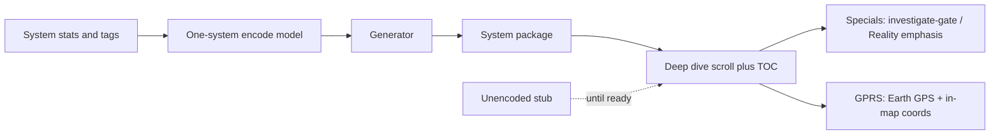

## Goal Capsule

**Objective:** Players can open a deep system atlas on Star Map 25 that reads rich per-system packages—real-science education, experimental creatures, imagery, and GPRS positioning—while the owner encodes one named system at a time through a generator model until all 25 are hand-rich.

**Means:** Ship the deep-dive shell and one-system encode model first; fill systems incrementally; treat investigate-gated archive and education-first Reality emphasis as specials on top of the package atlas.

**Product authority:** This plan owns the Starmap25 deep-dive atlas, system packages, creature loops, Reality science content, GPRS layers, and encode-one-system flow. MN2 star-system contracts are not active scope (separate project).

**Open blockers:** None that block planning. Outstanding items are deferred to planning or recorded as assumptions below.

## Product Contract

### Summary

Build an in-app **system package atlas** for Star Map 25: a scroll-first deep dive with sticky TOC that renders one encoded system package at a time.
The owner uses a stats-driven generator model to encode systems one-by-one; unencoded systems show a stub.
Packages carry Overview, real-science Reality, Creatures (catalog + collect + modifiers), Images (world plates + map UI captures), and GPRS (Earth GPS + in-map coordinates / nearby-star references).
Canonical star and planet names stay correct.
Investigate-gated archive and education-first Reality spine ship as **specials**, not the default shape.

### Problem Frame

Today Star Map 25 offers short lore, `lore_long` expand, and a 5-level planet-intel modal—not multi-page dossiers, creature catalogs, educational science depth, or a clear one-system encode pipeline.
The owner wants generator-driven beauty and science that saves time while still producing player engagement across all 25 systems.

### Key Decisions

- **System package atlas is the primary product shape** `(session-settled: user-directed — chosen over education-first-only and investigate-gated-only: atlas is the recommended core; others kept as specials)`. Governs R1, R2, R14.
- **Investigate-gated archive and education-first Reality spine are specials** on the atlas, not competing defaults. Governs R14.
- **In-app deep dive** inside `/starmap25`, not a separate lore library `(session-settled: user-directed — chosen over lore-library and hybrid)`. Governs R3.
- **Scroll-first dossier with sticky tabs as TOC** `(session-settled: user-directed — chosen over tabs-as-pages and tabs-as-anchors-only)`. Governs R3.
- **Creatures include catalog, discover/collect, and gameplay modifiers** `(session-settled: user-directed — all three over any single loop)`. Governs R6, R7, R8.
- **Reality content is real science** (astronomy, climate, biosphere) hooked to named fiction systems `(session-settled: user-directed — chosen over deep-canon-only and split co-equal fiction/science heroes)`. Governs R5.
- **Ship UI + encode model first; systems appear as encoded** `(session-settled: user-directed — chosen over batch gates and owner-only-until-all-25)`. Governs R2, R4.
- **Unencoded systems show a deep-dive stub** `(session-settled: user-directed — chosen over short-card-only and partial deep dive)`. Governs R4.
- **Hand-rich unique content is the all-25 quality bar**, delivered via the one-system encode line `(session-settled: user-directed — chosen over template-thin full map and pilot-only)`. Governs R2, R5, R6.
- **Screenshots are both world plates and map UI captures** `(session-settled: user-directed — chosen over either alone)`. Governs R9.
- **GPRS includes Earth GPS and in-map galactic positioning / nearby-star references** `(session-settled: user-directed — chosen over either alone)`. Governs R10, R11.
- **MN2 star-system contracts are out of this plan** `(session-settled: user-directed — deferred to a separate project)`. See Scope Boundaries.

<!-- ce-section: work-relationships -->
### How This Work Fits Together

This plan covers the **system package atlas** (deep dive, encode model, creatures, Reality science, GPRS, imagery).
Broader Starmap25 work understood so far (not a committed roadmap):

- **MN2 star-system contracts** — `Can proceed independently of` this plan; reserved as a separate project.
- **Existing investigate / units / invasion loops** — `Shares` system identity and tags with packages; this plan does not replace them.
- **Vidgenerator / content generator** — `Enables` the one-system encode path for science and beautiful plates.

### Actors

- **Owner / encoder** — runs the one-system generator encode model; judges time saved and content quality.
- **Player** — opens deep dives, reads Reality, collects creatures, sees GPRS; may use specials when offered.
- **System package** — the unit of content for one canonical star system (stats → encoded payload → atlas render).

### Requirements

**Atlas shell and encode**

- R1. Star Map 25 exposes a deep-dive atlas that reads one **system package** per named system, preserving canonical `host_star` and planet names from the existing map data.
- R2. A reusable **one-system encode model** accepts that system’s stats/tags and produces a complete package via the generator; the owner can encode systems one at a time until all 25 meet the hand-rich bar.
- R3. The default deep-dive presentation is a **long scroll** with a **sticky tab TOC** jumping to Overview, Reality, Creatures, and Images.
- R4. Until a system’s package is encoded, opening deep dive shows an explicit **stub** (encoding in progress / coming soon) that still displays the canonical system name.

**Reality science**

- R5. Each encoded package includes a **Reality** section of real-science education (astronomy, climate, biosphere, orbital ideas) useful for further learning, tied to that system’s identity and stats—not thin flavor text.

**Creatures**

- R6. Each encoded package includes an **experimental creature catalog** with fit readout against that planet/system’s stats and tags.
- R7. Players can **discover and collect** creatures through investigation-linked progress on that system.
- R8. Collected/fitted creatures can apply **light gameplay modifiers** to investigate / invade / build-style actions when fit matches the system (not a full separate combat sim in this plan).

**Imagery**

- R9. Encoded packages include **world plates** (planetary / creature / climate imagery) and **map UI captures** for that system.

**GPRS positioning**

- R10. The atlas supports **opt-in Earth GPS**: with permission, show the player’s real-time Earth position and an educational link into the Starmap25 view; if denied or unavailable, fall back without breaking the dossier.
- R11. The atlas supports **in-map GPRS**: live readout of the selected system’s map coordinates, updating when selection/map context changes, plus nearby-star sky references usable in Reality education.

**Progress and specials**

- R12. Existing investigate progress and system identity remain the shared spine; packages extend them rather than forking a second map of names.
- R13. Success for the owner includes a measurably **faster encode loop** than hand-writing full dossiers; success for players includes **actual use** of Reality reading and creature collect/modifier loops.
- R14. **Specials** (not default shape): (a) investigate-gated archive mode that treats dossier/creature depth as post-investigate rewards; (b) education-first Reality emphasis that elevates Reality as the hero read path on top of the same package.

### Key Flows

**F1. Owner encodes one system**
1. Owner picks a canonical system not yet rich (e.g. Fenris).
2. Encode model loads that system’s stats/tags/names.
3. Generator produces Reality, creatures, imagery slots, GPRS metadata into a package.
4. Package publishes; that system’s stub becomes the full deep dive.

**F2. Player opens deep dive**
1. Player selects a system on Star Map 25.
2. If no package → stub with canonical name.
3. If package present → scroll-first dossier; TOC jumps to Overview / Reality / Creatures / Images.
4. Optional specials may gate or emphasize sections per R14.

**F3. Creature collect and modifiers**
1. Player investigates (or meets the progress rule tied to that system).
2. Matching catalog creatures unlock into collection with fit vs stats shown.
3. Fitted creatures can apply light modifiers on eligible actions for that system.

**F4. GPRS**
1. Player may grant Earth GPS → “you are here” educational overlay.
2. Selecting a system updates in-map GPRS coordinates and nearby-star references in the dossier.

### Acceptance Examples

- AE1. When Mars is encoded and Terra is not, opening Mars shows the full scroll dossier; opening Terra shows a stub that still says Sol / Terra correctly.
- AE2. When a player opens an encoded Fenris Reality section, they get real-science climate/biosphere education tied to Fenris’s death-world / xenos-tagged stats—not only Imperium fiction blurbs.
- AE3. When a player collects a high-fit creature on a life-bearing / xenos-tagged world, the catalog shows the fit readout and the creature becomes available for light modifiers on that system.
- AE4. When Earth GPS permission is denied, the dossier still loads; in-map GPRS for the selected system continues to work.
- AE5. When the education-first Reality special is active, Reality is the emphasized read path without removing Overview / Creatures / Images from the package.
- AE6. When the investigate-gated special is active, full creature/dossier rewards require investigate on that system while the atlas shell behavior otherwise matches R3–R4.

### Success Criteria

- Owner can encode the next system via the model+generator with less wall-clock effort than writing an equivalent hand dossier from scratch.
- Players open Reality and use creature collect/modifier features on encoded systems (engagement, not shelfware).
- All 25 systems can reach the hand-rich bar through repeated one-system encodes without renaming stars/planets.

### Scope Boundaries

**In scope**
- System package atlas deep dive on Star Map 25
- One-system encode model + generator-produced science/beauty content
- Creatures: catalog, collect, light modifiers
- Reality real-science education
- World plates + map UI captures
- GPRS: opt-in Earth GPS + in-map coordinates / nearby-star refs
- Specials: investigate-gated archive; education-first Reality emphasis
- Preserving canonical names across all 25 systems

**Deferred for later**
- MN2 / MasterNoder2 star-system contracting (separate project)
- Full invasion/combat simulation beyond light creature modifiers
- Stepped-chapter deep-dive layout as the default

**Outside this product's identity**
- Replacing Star Map 25 investigate progression with a second unrelated map
- Real interstellar GPS hardware claims (Earth GPS is Earth-only; in-map GPRS is the beyond-Earth layer)

### Dependencies / Assumptions

- Existing `data/star_map_25.json` names, tags, `life_bearing` / `life_label`, lore, and coordinates remain the identity source for systems.
- Vidgenerator / generator surfaces are available to produce package media and science prose.
- Device GPS is opt-in; denied permission must not block the atlas.
- Nearby-star sky references are educational approximations tied to Reality, not a claim of live deep-space navigation.
- Default atlas does not require investigate to open an encoded package; investigate-gating is the special (R14a).

### Outstanding Questions

**Resolve Before Planning**
- None.

**Deferred to Planning**
- Exact package storage/publish shape and how stubs are detected.
- How specials are toggled in UI (per-user, per-system, global event).
- Creature modifier magnitude and which actions they touch.
- Source catalog for nearby-star sky coordinates and how they bind to fiction systems.
- Whether planet-intel’s existing 5-level modal is replaced, nested, or linked from the atlas.

### Sources / Research

- Grounding: existing monitor UI `lore_long` + planet-intel modal; `GET /api/star-map/25/planet-intel`; no creature catalog file yet; `/starmap25` route; generator surface under vidgenerator.
- Map identity: `data/star_map_25.json` (points, `host_star`, planets, tags, coordinates).
- Prior design notes: `docs/STARMAP_25_TOP10_IDEAS.md`, `docs/STARMAP25_UNITS_AND_INVASION_DESIGN.md` (adjacent, not replaced by this plan).
